# AegisCore AI

> **Evidence-Driven • Business-Impact-Aware • Policy-Constrained • Verified Cybersecurity Response**

[](https://www.python.org/)
[](https://fastapi.tiangolo.com/)
[](LICENSE)
[](https://schema.ocsf.io/)

---

## 🛡️ Executive Summary

**AegisCore AI** is an enterprise-grade, context-aware cybersecurity operations and response-coordination platform. Modern security teams face fragmented telemetry across identity providers, endpoint protection (EDR), cloud logs, and firewalls. Unchecked LLM automation risks devastating operational outages, while manual correlation is too slow to stop lateral movement.

AegisCore answers five critical questions for every significant security incident:
1. **What happened?** (Root-cause correlation across multi-source telemetry)
2. **What evidence supports that conclusion?** (End-to-end evidence provenance & auditability)
3. **What is the likely business impact?** (Graph-based dependency & blast-radius evaluation)
4. **Which response is permitted and proportionate?** (Deterministic policy gates & multi-factor risk scoring)
5. **Did the action actually achieve its objective?** (Independent, closed-loop postcondition verification)

---

## 🌟 Core Innovations & USPs

```
┌─────────────────────────────────────────────────────────────────────────────┐
│                             AEGISCORE AI ENGINE                             │
└──────────────────────────────────────┬──────────────────────────────────────┘
                                       │
     ┌─────────────────────────────────┼─────────────────────────────────┐
     ▼                                 ▼                                 ▼
┌─────────────────────────┐ ┌─────────────────────────┐ ┌─────────────────────────┐
│          USP 1          │ │          USP 2          │ │          USP 3          │
│ Business-Impact-Aware   │ │ Evidence-Gated,         │ │ Verified Remediation    │
│ Response Planning       │ │ Risk-Adaptive Autonomy  │ │ & Recovery Loop         │
├─────────────────────────┤ ├─────────────────────────┤ ├─────────────────────────┤
│ • Dependency graph      │ │ • Multi-dimensional     │ │ • Machine-checkable     │
│   traversal (Neo4j)     │   scoring (5 dimensions)  │   pre/postconditions      │
│ • Blast radius &        │ │ • Hard policy gates     │ │ • Fresh system state    │
│   service criticality   │   outside LLM context     │   independent checks      │
│ • Candidate action      │ │ • Evidence predicates & │ │ • Service health checks │
│   ranking               │   contradiction checks    │ • Rollback/recovery branch│
└─────────────────────────┘ └─────────────────────────┘ └─────────────────────────┘
```

### 1. Business-Impact-Aware Threat Response Planning
Rather than executing blind quarantine or server isolation that disrupts legitimate operations, AegisCore evaluates a versioned dependency subgraph (users, tokens, cloud resources, microservices, databases). It calculates security gain vs. blast radius, choosing targeted, high-reversibility actions (e.g., scoped session revocation) over disruptive containment whenever safe.

### 2. Evidence-Gated, Risk-Adaptive Autonomy
High model confidence does **not** grant automatic execution rights. Autonomy is governed by independent deterministic predicates evaluating five distinct dimensions:
* **Anomaly Score:** Statistical deviation of the observed behavior.
* **Threat Confidence:** Malicious intent probability grounded in telemetry.
* **Business Impact:** Criticality of affected dependencies.
* **Action Risk:** Scope, invasiveness, and reversibility of the proposed fix.
* **Evidence Sufficiency:** Explicit verification that mandatory evidence artifacts exist.

### 3. Verified Remediation and Recovery Loop
An API `200 OK` return code does not mean a threat has been contained. AegisCore implements a closed-loop controller:
* Captures machine-verifiable baseline state.
* Executes idempotent action through scoped connectors.
* Queries fresh state observations to verify security postconditions.
* Confirms service health and executes a policy-controlled rollback or escalation if anomalies persist.

---

## 🏗️ System Architecture & Data Flow

```mermaid
flowchart LR
    A[Raw Telemetry\nCloud, EDR, IdP, Network] --> B[Ingestion & Normalization\nOCSF Pydantic Schema]
    B --> C[Fast Detection\nRules & Isolation Forest]
    C --> D[Multi-Agent Investigation\nSentry ➔ Investigator ➔ Validator]
    D --> E[Context Graph\nNeo4j Asset Dependencies]
    E --> F[Decision Engine\nPolicy & Risk Evaluation]
    F --> G{Operating Mode}
    G -->|Default| H[Approval Queue\nHuman-in-the-Loop]
    G -->|Opt-In / Low Risk| I[Automated Connector\nScoped Execution]
    H --> I
    I --> J[Closed-Loop Verifier\nPostcondition & Health Check]
    J --> K[Durable Audit Record & Report]
```



### Specialized Multi-Agent Roles
* **Sentry:** Continuous monitoring, statistical feature extraction, anomaly flags. *(Cannot execute responses).*
* **Investigator:** Directed evidence gathering, provenance mapping, and timeline correlation. *(Cannot run arbitrary unvetted tools).*
* **Validator:** Corroboration verification, contradiction detection, and evidence sufficiency checks. *(Cannot override deny policies).*
* **Planner:** Compares candidate actions against security benefit and business dependency cost.
* **Executor:** Executes approved, scoped, idempotent remediation connectors.
* **Verifier:** Independent observer checking fresh postconditions and system health.

---

## 💻 Tech Stack

| Domain | Technologies |
| :--- | :--- |
| **Backend & Control Plane** | Python 3.12+, FastAPI, Pydantic v2, Uvicorn |
| **Workflow & State Machine** | LangGraph / Explicit State Machines |
| **Databases** | **Neo4j** (Dependency Graph), **PostgreSQL** (Durable Incidents & Audit), **Redis** (Cache & Rate Limiting) |
| **Telemetry & Ingestion** | Vector / Apache Kafka, OCSF Schema standard |
| **Frontend Dashboard** | React 18, TypeScript, Vite, Tailwind CSS, React Flow / Cytoscape.js |
| **AI / ML Integration** | scikit-learn (baseline anomaly detection), LLM Provider Abstraction layer |
| **Deployment & Observability** | Docker Compose, OpenTelemetry, Prometheus & Grafana |

---

## 📁 Repository Structure

```
aegiscore-ai/
├── apps/
│   ├── api/                   # FastAPI routes, control plane, and auth
│   └── dashboard/             # React + TypeScript SOC dashboard
├── services/
│   ├── ingestion/             # Adapters, parsers, OCSF normalization
│   ├── detection/             # Deterministic rules, Isolation Forest
│   ├── investigation/         # Sentry, Investigator, Validator agents
│   ├── context_graph/         # Neo4j schema and dependency queries
│   ├── risk/                  # 5D scoring, blast radius calculator
│   ├── policy/                # OPA/custom policy engine, allowlists
│   ├── response/              # Connectors, executor, and verifier loop
│   ├── reporting/             # Incident report generator
│   └── audit/                 # Append-only cryptographic audit logs
├── schemas/                   # OCSF events, incidents, actions, policies
├── docs/                      # Architecture, threat model, research & patents
├── infrastructure/            # Docker Compose, DB migrations, telemetry
└── tests/                     # Unit, integration, and scenario replay suites
```

---

## 🚦 Operating Modes

1. **Approval Mode (Default):**
   * Previews full incident context, evidence provenance, proposed action, alternatives, and estimated blast radius.
   * Requires cryptographically bound authentication and role-based sign-off before changes take effect.
2. **Automatic Mode (Explicit Opt-In):**
   * Strictly restricted to Tier 0 (read-only queries) and Tier 1 (low-impact, high-reversibility actions in sandbox/lab environments).
   * Production-grade infrastructure modifications always mandate human sign-off.

---

## 📚 Detailed Documentation

* [Architecture & Data Flow](docs/ARCHITECTURE.md)
* [Security & Threat Model](docs/THREAT_MODEL.md)
* [Research Strategy & Patent Exploration](docs/RESEARCH_AND_PATENTS.md)
* [Data Models & OCSF Schema](docs/API_AND_DATA_MODELS.md)

---

## 📄 License & Intellectual Property Notice

This repository contains the design, reference architecture, and implementation blueprint for AegisCore AI. All research directions and provisional invention mechanisms are subject to intellectual property and patent review. Released under the [Apache 2.0 License](LICENSE).
