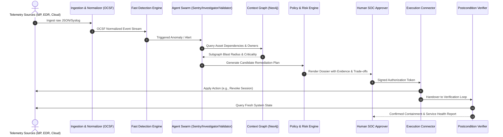

# AegisCore AI: Architecture & System Design

This document details the architectural principles, component decomposition, data ingestion flow, multi-agent coordination, and closed-loop verification protocols underpinning AegisCore AI.

---

## 1. Architectural Principles

1. **Evidence Grounding over Generative Hallucination:** No claim or state assertion is made without explicit traceability to an OCSF telemetry record. LLMs are never permitted to hallucinate CVEs, ATT&CK techniques, or post-action success.
2. **Deterministic Security Boundary:** Policy validation, allowlists, and execution gates execute as pure deterministic code isolated from generative model weights.
3. **Graph-Contextualized Impact:** Remediation choices are directly evaluated against an live asset and dependency graph in Neo4j to measure downstream operational risk.
4. **Independent Closed-Loop Verification:** Execution receipt (`HTTP 200`) is treated merely as command acknowledgment. Remediation success requires independent postcondition verification.

---

## 2. End-to-End Pipeline

---

## 3. Component Deep Dive

### 3.1 Normalization & Event Schema
Every ingested event is validated against a Pydantic model aligned with the **Open Cybersecurity Schema Framework (OCSF)**.

* **Tenant Boundary:** Strict tenant separation enforced at database partition and message layer.
* **Immutability:** Raw incoming payloads are stored with SHA-256 hashes in object storage (MinIO/S3) as immutable evidence references.

### 3.2 The Multi-Agent Investigation Loop
AegisCore uses a bounded, stateful agent loop orchestrated via **LangGraph**:

* **Sentry Agent:**
  * Runs feature extraction and simple statistical anomaly models (Isolation Forest).
  * Flagging an anomaly triggers downstream investigation but *never* directly triggers remediation.
* **Investigator Agent:**
  * Queries corroborating logs across correlated time windows.
  * Employs strictly bounded toolsets with rate limits, query timeouts, and circuit breakers.
* **Validator Agent:**
  * Tests for hypothesis contradictions (e.g., failed login flagged as brute-force when concurrent MFA succeeded from an authorized corporate IP).
  * Scores **Evidence Sufficiency** against mandatory policy checklists.
* **Planner Agent:**
  * Generates candidate actions (e.g., full host isolation vs. ephemeral token revocation vs. security group tightening).
  * Evaluates service impact using the Neo4j dependency model.
* **Executor Agent:**
  * Dispatches authorized, scoped, idempotent commands via secured connectors.
* **Verifier Agent:**
  * Performs active post-action health checks and validates containment postconditions.

---

## 4. Neo4j Context & Dependency Graph

AegisCore models enterprise topology in Neo4j to quantify blast radius before taking disruptive action:

### Node Types
* `Identity`: Users, Service Accounts, IAM Roles.
* `Endpoint`: Laptops, Production Servers, Containers, Pods.
* `Service`: Business APIs, Internal Microservices, Batch Jobs.
* `DataStore`: Databases, S3 Buckets, Cache Clusters.
* `NetworkZone`: VPCs, Subnets, Zero-Trust Microsegments.

### Edge Relationships
* `(:Identity)-[:AUTHENTICATED_TO]->(:Endpoint)`
* `(:Endpoint)-[:HOSTS]->(:Service)`
* `(:Service)-[:DEPENDS_ON]->(:Service)`
* `(:Service)-[:READS_WRITES]->(:DataStore)`
* `(:Team)-[:OWNS]->(:Service)`

### Blast-Radius Quantification
Before an action (such as isolating an Endpoint or disabling an IAM Role) is proposed, the engine performs a Breadth-First Search (BFS) / Dijkstra traversal from the target entity up through all dependent `Service` nodes. Each service carries a `CriticalityTier` (Tier 1 mission-critical, Tier 2 standard, Tier 3 development). The algorithm ranks containment actions to optimize:

$$\text{Action Score} = \alpha \cdot (\text{Containment Efficacy}) - \beta \cdot (\text{Disrupted Business Criticality}) + \gamma \cdot (\text{Reversibility})$$

---

## 5. Closed-Loop Verification Protocol

Traditional security orchestration systems assume a task is finished when an API endpoint returns `200 OK`. AegisCore enforces a three-phase execution contract:

1. **Precondition Audit:** Validate baseline state (e.g., target user session is currently active; connector credentials are valid).
2. **Idempotent Execution:** Send scoped request with a cryptographically unique `idempotency_key` and bounded retry budget.
3. **Independent Postcondition Verification:**
   * Query fresh system logs or identity introspection endpoints directly.
   * Verify target token is explicitly rejected upon subsequent use.
   * Query service health checks (`/healthz` endpoints, Prometheus metrics) of dependent upstream services to guarantee zero unintended collateral failure.
   * If postconditions fail or return ambiguous status, enter an authorized rollback or human escalation branch immediately.
